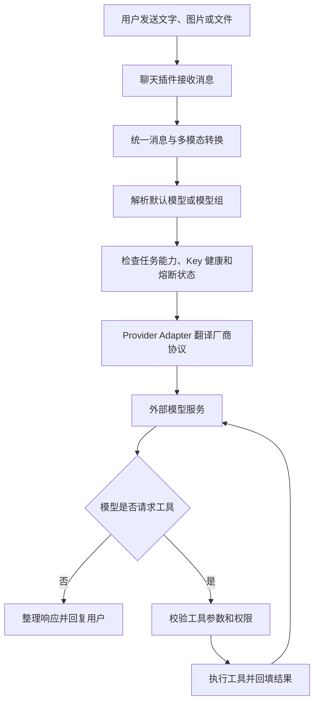

# AI 能力部署与使用指南

本文面向 PoleSudBot 的部署者和管理员，介绍如何接入大模型、当前可以直接使用哪些 AI 功能，以及一次 AI 请求在 Bot 内部是怎样运行的。

如果你要开发插件或维护 AI 框架，请阅读 [AI 智能体框架使用说明](./agent/ai-framework.md)。本文不要求读者了解 Python 实现细节。

## 先看结论

PoleSudBot 现在有一套统一 AI 服务。你只需要在一个地方配置模型供应商和默认模型，群聊总结、智能帮助、AI 绘图、图片文字识别等第一方功能就可以共用同一套模型管理、消息转换、重试和错误处理能力。

目前仓库开箱即用的 AI 功能包括：

- 智能帮助：理解自然语言需求，告诉用户应该使用哪个 Bot 命令；
- 群聊总结：按消息数量、时间范围、用户或关键词总结群聊；
- AI 绘图：文生图、图生图和提示词优化；
- Quote 图片文字识别：用视觉模型识别语录图片文字，并可与 PaddleOCR 互相回退；
- RollPig AI 文案：为烤猪玩法生成文案，失败时回退到本地模板；
- 超级用户模型管理：查看模型、测试连通性、检查 Key 状态和管理 MCP 服务。

需要特别说明：**当前仓库没有内置面向普通用户的通用连续聊天命令**。底层框架已经支持聊天、多模态、工具调用、记忆、RAG 和智能体，但还需要聊天插件把这些能力暴露成类似 `AI聊天` 的用户命令。仅配置 API Key 不会自动出现聊天入口。

## 五分钟最小配置

### 1. 准备模型服务

你至少需要一个大模型服务的 API Key。可以使用 Gemini、DeepSeek、OpenAI 兼容网关、GLM、豆包、OpenRouter 等服务。

下文使用 Gemini 和 DeepSeek 作为示例。模型名称和可用性会随服务商变化，请以你的服务商控制台为准。

### 2. 首次启动 Bot

按照仓库 README 完成基础部署并至少启动一次：

```bash
uv run bot.py
```

首次启动会注册 AI 和插件配置。部署者日常编辑的是 `data/config.yaml`，不建议直接维护内部的 `data/configs/plugins2config.yaml`。

### 3. 编辑 AI 配置

在 `data/config.yaml` 中加入或修改 `AI` 配置组。最小的纯聊天配置可以写成：

```yaml
AI:
  DEFAULT_MODELS:
    chat: Gemini/gemini-3.5-flash

  SANDBOX:
    enable_sandbox: false

  PROVIDERS:
    - name: Gemini
      api_key:
        - YOUR_GEMINI_API_KEY
      api_base: https://generativelanguage.googleapis.com
      api_type: gemini
      models:
        - model_name: gemini-3.5-flash
```

请把 `YOUR_GEMINI_API_KEY` 替换为自己的 Key。不要把真实 Key 提交到 Git、发到群聊或放进截图；如果 Key 已经公开，应立即到服务商控制台轮换。

配置多个任务模型和备用线路时，可以扩展为：

```yaml
AI:
  DEFAULT_MODELS:
    chat: chat_fallback
    embedding: Gemini/gemini-embedding-2
    image: Gemini/gemini-2.5-flash-image
    tts: Gemini/gemini-3.1-flash-tts-preview
    rerank: SiliconFlow/BAAI/bge-reranker-v2-m3

  CLIENT_SETTINGS:
    timeout: 300
    max_retries: 3
    retry_delay: 2
    structured_retries: 2
    proxy:

  MODEL_GROUPS:
    chat_fallback:
      - Gemini/gemini-3.5-flash
      - DeepSeek/deepseek-chat

  SANDBOX:
    enable_sandbox: false

  PROVIDERS:
    - name: Gemini
      api_key:
        - YOUR_GEMINI_API_KEY
      api_base: https://generativelanguage.googleapis.com
      api_type: gemini
      models:
        - model_name: gemini-3.5-flash
        - model_name: gemini-embedding-2
        - model_name: gemini-2.5-flash-image

    - name: DeepSeek
      api_key:
        - YOUR_DEEPSEEK_API_KEY
      api_base: https://api.deepseek.com
      api_type: deepseek
      models:
        - model_name: deepseek-chat
```

不必为了“配置完整”而购买或填写所有类型的模型。只配置实际会使用的任务即可；例如只使用群聊总结和智能帮助时，只需要聊天模型。

### 4. 重启并测试

保存配置后重启 Bot，再由超级用户执行：

```text
llm list --text
llm info Gemini/gemini-3.5-flash
llm test Gemini/gemini-3.5-flash
llm keys Gemini
```

- `llm list --text`：查看已经注册的模型名称；
- `llm info`：查看模型详情和框架识别到的能力；
- `llm test`：发起一次最小连通性测试，会实际消耗少量额度；
- `llm keys`：查看同一 Provider 下各个 Key 的健康状态。

这些命令只允许超级用户使用。

## Provider、Model 和默认模型是什么

可以把整套配置理解为：

- **Provider**：供应商或中转网关，例如 Gemini、DeepSeek、OpenRouter；
- **Model**：该供应商提供的具体模型；
- **Adapter**：Bot 内部的协议翻译器，把统一请求转换成不同厂商的格式；
- **Default Model**：某一类任务没有显式指定模型时使用的默认值；
- **Model Group**：按顺序排列的主备模型线路。

模型统一写成 `Provider/Model`。框架只在第一个 `/` 处分隔，因此下面这种带多级名称的模型也是合法的：

```text
SiliconFlow/BAAI/bge-reranker-v2-m3
```

其中 Provider 是 `SiliconFlow`，Model 是 `BAAI/bge-reranker-v2-m3`。

### 按任务设置默认模型

`AI.DEFAULT_MODELS` 支持这些任务：

| 配置项 | 用途 | 常见功能 |
| --- | --- | --- |
| `chat` | 文本或多模态生成 | 智能帮助、群聊总结、OCR、Agent |
| `embedding` | 把文本或媒体转成向量 | RAG、相似度检索 |
| `image` | 生成或编辑图片 | AI Creation 的 API 绘图 |
| `tts` | 文字转语音 | 需要语音回复的插件 |
| `rerank` | 对检索结果重新排序 | RAG 精排 |

插件也可以指定自己的模型；插件专用配置通常优先于全局默认模型。

### 模型组和故障转移

单独配置一个模型时，请求默认只会使用该模型。想要自动切换备用模型，需要先定义 `MODEL_GROUPS`，再把默认模型或插件模型设为组名：

```yaml
AI:
  DEFAULT_MODELS:
    chat: chat_fallback
  MODEL_GROUPS:
    chat_fallback:
      - Gemini/gemini-3.5-flash
      - DeepSeek/deepseek-chat
```

请求时框架会按列表顺序选择可用模型，跳过处于熔断状态或不支持当前任务的节点。对于明确不可恢复的配置错误、鉴权错误等，框架可能直接返回错误，而不是无条件把所有模型都试一遍。

同一个 Provider 可以配置多个 Key。框架会轮询 Key，并记录限流、鉴权和可用状态；这和模型组是两层机制：多个 Key 解决同一供应商账号线路的问题，模型组解决不同模型或供应商之间的主备问题。

## 当前可以直接使用的功能

### 智能帮助

在 `data/config.yaml` 中启用：

```yaml
help:
  ENABLE_LLM_HELPER: true
  DEFAULT_LLM_MODEL: Gemini/gemini-3.5-flash
```

用户仍然使用原来的帮助入口：

```text
功能 我想总结最近两小时的群聊
帮助 怎么把一张图改成赛博朋克风格
```

当传统帮助找不到精确插件名称时，AI 会读取当前用户有权限看到的插件说明，并告诉他适合使用哪个命令。它不会绕过插件权限，也不会直接替用户执行目标命令。

### 群聊总结

常见命令：

```text
总结 200
总结 2h
总结 今日
总结 300 @某位用户
总结 500 关键词
总结 100 -p 正式汇报
今日总结
昨日总结
定时总结 23:30 今日
定时总结取消
总结模型 列表
总结模型 设置 Gemini/gemini-3.5-flash
总结配置
```

它可以按最近消息数量、相对时间、指定时间段、指定用户或关键词筛选聊天记录，再交给模型生成摘要。管理员可以为群设置默认风格和定时总结；超级用户可以选择全局或群级模型。

群聊总结会把被选中的聊天记录发送给配置的模型服务。部署前应确认群规则、隐私告知和服务商数据政策符合你的使用场景。

### AI 绘图

使用 API 绘图引擎时，可以配置：

```yaml
ai_creation:
  ENABLE_API_DRAW_ENGINE: true
  API_DRAW_MODEL: Gemini/gemini-2.5-flash-image
  ENABLE_DRAW_PROMPT_OPTIMIZATION: false
  AUXILIARY_LLM_MODEL: Gemini/gemini-3.5-flash
```

使用示例：

```text
draw 一只可爱的小猫 -e api
draw [附带图片] -o on 换成赛博朋克风格
draw -t 手办 @用户
绘图模板 list
```

开启提示词优化后，会先调用辅助聊天模型润色描述，再调用绘图模型，因此一次绘图可能产生两次模型费用。图生图会把用户图片发送给模型服务。

### Quote 图片文字识别

Quote 上传语录时可以使用 AI 视觉模型或 PaddleOCR：

```yaml
quote:
  TEXT_RECOGNITION_PRIORITY: llm
  BATCH_TEXT_RECOGNITION_PRIORITY: paddleocr_api
  AI_ENABLED: true
  OCR_AI_MODEL: Gemini/gemini-3.5-flash
  PADDLEOCR_API_TOKEN: YOUR_PADDLEOCR_TOKEN
```

用户回复一张图片并发送：

```text
上传语录
```

插件会按配置优先级识别图片文字。首选服务没有结果或请求失败时，可以回退到另一种识别方式。`OCR_AI_MODEL` 必须是支持图片输入的模型；只有文本能力的模型无法完成该任务。

### RollPig AI 文案

启用后，`今日烤猪`、`烤群友` 等玩法会尝试生成 AI 文案：

```yaml
nonebot_plugin_rollpig:
  AI_ENABLED: true
  LLM_MODEL_NAME: Gemini/gemini-3.5-flash
```

`LLM_MODEL_NAME` 留空时使用全局聊天默认模型。模型调用失败不会影响基础玩法，插件会回退到本地文案模板。

### MCP 管理

超级用户可以使用：

```text
llm mcp
llm mcp 开启 <ID或名称>
llm mcp 关闭 <ID或名称>
llm mcp 重载
```

MCP 是连接外部工具服务的标准协议。启用 MCP 服务相当于给 AI 增加新的“手脚”，可能允许它查询网络、访问业务系统或执行其他操作。不要启用来源不明的 MCP 配置；先阅读它的命令、网络和文件权限，再在隔离环境中测试。

## 一次 AI 请求背后发生了什么

以未来可能安装的通用 AI 聊天插件为例，一次请求的运行链路如下：



框架在这条链路中还会统一处理：

- 请求超时和有限重试；
- 模型组故障转移；
- 多 Key 轮询和健康状态；
- 文本、图片、音频、视频和文件消息转换；
- 模型任务能力检查和不支持模态的过滤；
- 缓存、上下文压缩、输出校验和错误友好化；
- 用量信息和运行日志。

这意味着插件不需要为 Gemini、DeepSeek 和 OpenAI 兼容服务分别实现一套请求代码。更换服务商时，通常只需要调整配置和模型名。

## AI 聊天、工具和智能体的关系

普通聊天模型只能根据收到的上下文生成内容。工具和智能体让模型可以在受控范围内“做事”。

一次工具调用通常是：

```text
用户提问
  → 模型判断需要调用工具
  → 框架校验工具名称、参数和权限
  → Bot 执行工具
  → 工具结果返回模型
  → 模型继续调用工具或生成最终回答
```

例如，一个天气聊天插件可以只向 Agent 开放“查询天气”工具。模型可以请求查询北京天气，但不能因此自动获得读取服务器文件、执行 Shell 或管理群成员的能力。

框架设置了单 Agent 循环上限和整个会话的全局循环上限，用于避免模型在工具之间无限打转。工具仍应由插件开发者显式注册，并声明权限、参数、超时和必要的人工确认。

## Memory、RAG、MCP 和 Sandbox

这些词可以这样理解：

| 能力 | 通俗解释 | 适合场景 | 默认情况 |
| --- | --- | --- | --- |
| Memory | 按会话保存历史和摘要 | 连续对话、用户偏好 | 由插件选择是否启用 |
| RAG | 先检索资料，再把相关内容交给模型回答 | 知识库问答、文档搜索 | 需要插件准备知识源和向量模型 |
| MCP | 标准化的外部工具插座 | 搜索、业务 API、外部服务 | 不应默认启用未知服务 |
| Sandbox | 隔离的代码或命令执行环境 | 计算、文件处理、自动化任务 | 全局默认关闭 |

### Memory 不是无限记忆

Memory 会按会话或业务范围隔离消息，并在上下文过长时进行摘要压缩。是否长期保存、保存多久、不同群和用户是否隔离，取决于聊天插件采用的存储和会话 ID 设计。部署者不应把“支持 Memory”理解成 Bot 会自动记住所有群聊。

### RAG 不是模型自动知道本地资料

RAG 需要先把文档读取、切分和建立索引，提问时再检索相关片段。通常还需要 `embedding` 模型，可能再使用 `rerank` 模型精排。只有插件实际绑定了知识库，模型才会得到这些资料。

### Sandbox 默认关闭

默认配置是：

```yaml
AI:
  SANDBOX:
    enable_sandbox: false
```

关闭时 Bot 正常启动，不要求安装或运行 Docker。只有明确需要隔离执行代码的插件才应开启 Sandbox。开启前需要准备对应运行环境，并认真限制挂载目录、网络访问、镜像来源和资源用量。

## 当前“AI 聊天”能做到什么程度

底层框架已经能够支持聊天插件实现以下能力：

- 文字和图片混合对话；
- 连续会话与上下文压缩；
- 根据用户、群、频道或业务隔离记忆；
- 查询知识库后回答；
- 调用经过注册和授权的 Bot 工具；
- 将复杂任务拆给多个 Agent，或按固定 Workflow 执行；
- 在模型或 Key 暂时不可用时进行有限重试和故障转移；
- 对结构化结果进行 Schema 校验，适合信息提取和自动化流程。

它不能自动保证：

- 回答永远正确或没有幻觉；
- 模型自动知道实时信息、本地文件或群历史；
- 未注册的工具可以被调用；
- 配置了 Memory 就一定永久记住所有内容；
- 开启备用模型后所有错误都能自动恢复；
- 不经过权限设计就安全执行高风险操作。

当前仓库缺少的只是一个面向普通用户的通用聊天命令和具体产品策略，例如唤醒方式、会话过期时间、人格设定、群聊触发规则、配额、记忆范围和允许使用的工具。部署者可以安装兼容插件，或让开发者基于统一 AI 服务实现这些入口。

## 成本、隐私和安全

部署 AI 功能前，建议明确以下事项：

1. **模型费用**：聊天按输入和输出 Token 计费，图片、语音、Embedding 和重排通常分别计费；工具循环会产生多次模型请求。
2. **数据发送范围**：群聊总结会发送选中的聊天记录，视觉功能会发送图片，RAG 会发送检索片段；第三方服务会按其隐私政策处理数据。
3. **最小权限**：只给 Agent 注册完成任务必需的工具；管理、删除、支付、发消息等动作应增加权限校验或人工确认。
4. **密钥保护**：不要提交、截图或分享 `data/config.yaml` 中的 Key，日志和错误报告也应先脱敏。
5. **功能灰度**：先在测试群或白名单中验证模型质量、费用和失败行为，再扩大使用范围。
6. **外部能力**：开启 MCP、Sandbox、网络搜索或文件访问前，先确定它们能够访问什么、由谁触发、结果会发给谁。

## 常见问题

### `llm list --text` 没有模型

检查 `AI.PROVIDERS` 是否为 YAML 列表、缩进是否正确，以及每个 Provider 是否至少包含 `name`、`api_key`、`api_type` 和 `models`。修改后重启 Bot。

### `llm test` 提示鉴权或连接失败

依次检查 API Key、`api_base`、`api_type`、代理和服务商区域限制。`api_base` 应填写 API 根地址，不要随意复制某个具体聊天接口的完整路径。

### 配了两个模型但不会自动切换

仅把两个模型写进 `PROVIDERS` 不会自动形成主备。需要创建 `MODEL_GROUPS`，并把 `DEFAULT_MODELS.chat` 或插件的模型配置设为该组名。

### 视觉 OCR 或图生图失败

确认所选模型支持图片输入，并且模型已经列在对应 Provider 的 `models` 中。普通文本模型即使能正常聊天，也不一定支持视觉任务。

### 配好模型后为什么不能直接和 Bot 聊天

因为统一 AI 服务是底层能力，不是用户命令。当前仓库内置了智能帮助、总结、绘图、OCR 等具体入口，但没有通用聊天插件。需要额外安装或开发聊天插件。

### Sandbox 关闭会影响普通 AI 功能吗

不会。聊天、总结、视觉识别、绘图、Embedding 和大多数工具都不要求 Sandbox。只有明确声明需要隔离执行环境的工具会在 Sandbox 关闭时报错。

### 修改配置后没有生效

先检查是否编辑了 `data/config.yaml`，再检查 YAML 缩进和键名，最后重启 Bot。`data/configs/plugins2config.yaml` 是注册配置的内部文件，不建议把它作为日常配置入口。

## 旧配置升级

旧的配置项仍可作为兼容回退：

```yaml
AI:
  DEFAULT_MODEL_NAME: Gemini/gemini-3.5-flash
```

当没有配置 `DEFAULT_MODELS.chat` 时，框架会把它作为聊天默认模型读取，但不会自动改写数据库或配置文件。新部署建议改为：

```yaml
AI:
  DEFAULT_MODELS:
    chat: Gemini/gemini-3.5-flash
```

旧的 `zhenxun.services.llm` 代码入口也保留了兼容门面，主要用于尚未迁移的外部插件。部署者无需为此修改 vendor 插件；第一方新功能会使用新的统一 AI 服务。

## 上线前检查清单

- [ ] `AI.PROVIDERS` 中没有示例 Key，模型名与服务商控制台一致；
- [ ] `AI.DEFAULT_MODELS.chat` 指向真实模型或有效模型组；
- [ ] 使用 `llm list --text` 确认模型已经注册；
- [ ] 使用 `llm test Provider/Model` 验证最小请求；
- [ ] 只启用了实际需要的插件 AI 功能；
- [ ] 已了解群聊、图片和知识库内容会发送给哪个服务商；
- [ ] 已设置费用限额、调用频率或服务商告警；
- [ ] MCP 和 Sandbox 保持关闭，或已经完成单独的权限与隔离审计；
- [ ] 已在测试群验证成功、超时、限流和模型不可用时的表现；
- [ ] 没有把真实 API Key 提交到 Git 或发到公开位置。
